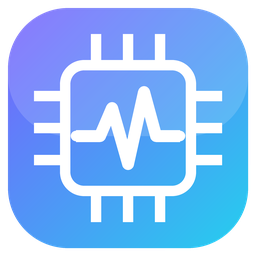

<p align="center">
  
</p>

<h1 align="center">HWUltimate</h1>

<p align="center">
  <b>Your Hardware. Every Detail. One Place.</b><br/>
  Open-source hardware monitor and system information tool for Windows 10 / 11 (x64)
</p>

<p align="center">
  <a href="https://github.com/eren-agalar/HWUltimate/releases/latest"></a>
  <a href="LICENSE"></a>
  
  
</p>

<p align="center"><a href="#english">English</a> · <a href="#türkçe">Türkçe</a></p>

---

## English

HWUltimate shows every sensor your PC exposes — temperatures, clocks, voltages, power, fans, load — in a clean
classic tree, and identifies every component in detail. It runs on any Intel / AMD processor and any NVIDIA / AMD /
Intel graphics card: nothing is written for one particular model.

**Values are never invented.** If the hardware does not report something, HWUltimate shows *Not Available* and
says why.

### Features

| | |
|---|---|
| **Sensors** | Device → group → sensor tree with **Sensor · Value · Min · Max** columns (Average and technical columns optional). Every core temperature is listed under *Temperatures*. Motherboard Super I/O / EC sensors appear under the motherboard. |
| **Clean by default** | Unused sensors are hidden: inputs that never reported a value, empty fan headers, unconnected voltage / temperature inputs, virtual or disconnected network adapters (Hyper-V, WSL, VPN…). *Show all sensors* brings them back. |
| **Hide permanently** | Hide any sensor, a whole device or a sensor group. It stays hidden after restarts — even when drives are renumbered at boot — until you show it again from the *Hidden* list. Favourites, pins, custom order, search, filters and sorting. |
| **Complete detection** | *Rescan hardware* detects again without restarting. Detection is repeated automatically right after start-up when it looks incomplete, and unavailable sources are retried. |
| **Hardware information** | Device tree and a *Feature · Description · Source* table, plus a **System summary** page (processor, graphics, motherboard, memory modules, drives, displays, network, Windows). Every value shows where it came from: official specification, detected, live or not available. Copy and export to HTML / JSON / text. |
| **Silicon quality** | For processors, the factory per-core ranking (Intel *favored cores* / AMD *preferred cores*) that Windows reads from the firmware: best cores, full order, P- and E-cores separately. |
| **Reports** | System summary, inventory, CPU, GPU, memory, storage and current readings as HTML, CSV, JSON or text, with a live preview. |
| **Design** | Dark, Light, Midnight, Ocean or follow Windows; accent colour, density, text size; animated vector logo. English and Turkish. |
| **Automatic updates** | HWUltimate checks GitHub Releases shortly after start and every 6 hours. When a new version is published it shows a notification (and flashes the taskbar); *Download and install* fetches it, verifies its SHA-256 and restarts into the new version, keeping your settings. A failed install rolls back. Can be turned off in Settings. |
| **Privacy** | No telemetry, no accounts. The only network connection is the update check to GitHub (can be turned off); nothing about your computer is sent. Everything stays in `%LOCALAPPDATA%\HWUltimate`. |

### Download and run

1. Download `HWUltimate-…-win-x64.zip` from **[Releases](https://github.com/eren-agalar/HWUltimate/releases/latest)** and extract it.
2. Install the **[.NET 10 Desktop Runtime (x64)](https://dotnet.microsoft.com/download/dotnet/10.0)** if you do not have it.
3. Run `HWUltimate.exe` and accept the administrator prompt (needed for motherboard, voltage and many CPU sensors).
4. For motherboard, fan, voltage and per-core CPU sensors, install the **[PawnIO](https://pawnio.eu/)** driver, then press *Rescan hardware* — no restart needed. HWUltimate shows a banner when it is missing.

> Windows SmartScreen may warn because the executable is not code-signed. Choose *More info → Run anyway*, or build it yourself from source.

Upgrading from *Nova Hardware*: settings, hidden sensors and reports are copied automatically from `%LOCALAPPDATA%\NovaHardware` on first start. The old folder is not touched.

### Good to know

- **AMD Ryzen**: AMD exposes Tctl/Tdie and per-CCD temperatures, not one temperature per core; the sensor library does not provide per-core temperatures on Ryzen and HWUltimate does not derive them. Intel processors report every core.
- **Silicon quality score**: Intel, AMD, NVIDIA and Windows expose no percentage "ASIC quality" for current hardware, so none is shown. The per-core ranking above is the real, readable indicator.
- **AMD ADLX** is detected but not yet used for metrics; AMD GPU sensors come from LibreHardwareMonitor.
- The executable is not code-signed.

### Build from source

Requires the .NET 10 SDK.

```bash
git clone https://github.com/eren-agalar/HWUltimate.git
cd HWUltimate
dotnet build HWUltimate.sln -c Release
dotnet test --project tests/HWUltimate.Tests -c Release
dotnet publish src/HWUltimate.App -c Release -r win-x64 --self-contained false -o publish
```

Add `--self-contained true` for a build that does not need the .NET runtime (larger). UI strings live in
`tools/strings.py` (English and Turkish); run `python3 tools/strings.py` to regenerate the resource files.
The logo is drawn by `src/HWUltimate.UI/Controls/HwuLogo.cs`; `python3 tools/logo.py` renders the icon files.

<details>
<summary>Project structure</summary>

```
src/HWUltimate.Domain           Models (sensor readings, devices, inventory, reports)
src/HWUltimate.Core             Polling, device identity merging, sensor tree, detection rules, reports
src/HWUltimate.Hardware         LibreHardwareMonitor provider, Windows memory counters
src/HWUltimate.Hardware.Nvidia  NVAPI / NVML provider
src/HWUltimate.Hardware.Amd     ADLX loader
src/HWUltimate.Infrastructure   CPUID, SMBIOS, WMI, SetupAPI, DXGI / Vulkan, CPU sets, settings, logging
src/HWUltimate.UI               Design system, themes, icons, logo, localisation (en, tr)
src/HWUltimate.App              WPF application (MVVM)
src/HWUltimate.Storage          SQLite history (not used by the app)
src/HWUltimate.Benchmark        Stress engine (not used by the app)
tests/HWUltimate.Tests          xUnit tests
tools/                          strings.py, logo.py, icons.json, HwuPerf benchmark
```
</details>

### Publishing a release

1. Set `<Version>` in `Directory.Build.props` (e.g. `0.3.1`) and optionally add notes in `docs/releases/v0.3.1.md`.
2. Commit, then push a matching tag:

```bash
git tag v0.3.1
```

```bash
git push origin v0.3.1
```

The `release` workflow builds and tests on Windows, uploads `HWUltimate-v0.3.1-win-x64.zip` and its `.sha256`, and
creates the GitHub release. Installed copies notify their users and can update from inside the app.

### Contributing

Issues and pull requests are welcome. Please keep the core rule: never show a value the hardware did not report,
and never write code for one specific model when a general rule works.

### License

[MIT](LICENSE). Third-party components and their licences: [THIRD-PARTY-NOTICES.md](THIRD-PARTY-NOTICES.md)
(LibreHardwareMonitorLib is MPL-2.0 and shipped unmodified). PawnIO, NVIDIA NVAPI / NVML and AMD ADLX are not
bundled; they come from their own installers and drivers.

---

## Türkçe

HWUltimate, bilgisayarınızın bildirdiği tüm sensörleri (sıcaklık, saat hızı, voltaj, güç, fan, kullanım) sade ve
klasik bir ağaç görünümünde gösterir ve her bileşeni ayrıntılı olarak tanımlar. Her Intel / AMD işlemcide ve her
NVIDIA / AMD / Intel ekran kartında çalışır; hiçbir şey belirli bir modele göre yazılmamıştır.

**Değerler asla uydurulmaz.** Donanım bir bilgiyi bildirmiyorsa HWUltimate *Yok* gösterir ve nedenini yazar.

### Özellikler

| | |
|---|---|
| **Sensörler** | Cihaz → grup → sensör ağacı; **Sensör · Değer · Min · Max** sütunları (Ortalama ve teknik sütunlar isteğe bağlı). Her çekirdeğin sıcaklığı *Sıcaklıklar* altında listelenir. Anakartın Super I/O / EC sensörleri anakartın altında görünür. |
| **Varsayılan olarak sade** | Kullanılmayan sensörler gizlenir: hiç değer bildirmeyen girişler, boş fan girişleri, bağlı olmayan voltaj / sıcaklık girişleri, sanal veya bağlı olmayan ağ bağdaştırıcıları (Hyper-V, WSL, VPN…). *Tüm sensörleri göster* ile geri gelirler. |
| **Kalıcı gizleme** | Herhangi bir sensörü, tüm bir cihazı veya bir sensör grubunu gizleyin. *Gizli* listesinden tekrar gösterene kadar, diskler açılışta yeniden numaralansa bile, yeniden başlatmalardan sonra da gizli kalır. Favoriler, sabitleme, özel sıralama, arama, filtre ve sıralama. |
| **Eksiksiz algılama** | *Donanımı yeniden tara* uygulamayı yeniden başlatmadan tekrar algılar. Algılama eksik görünürse açılıştan hemen sonra otomatik tekrarlanır; çalışmayan kaynaklar yeniden denenir. |
| **Donanım bilgisi** | Cihaz ağacı ve *Özellik · Açıklama · Kaynak* tablosu; ayrıca işlemci, ekran kartı, anakart, bellek modülleri, diskler, monitörler, ağ ve Windows'u tek sayfada gösteren **Sistem özeti**. Her değerin nereden geldiği gösterilir: resmi özellik, algılanan, canlı veya yok. HTML / JSON / metin olarak kopyalama ve dışa aktarma. |
| **Silikon kalitesi** | İşlemciler için Windows'un ürün yazılımından okuduğu fabrika çekirdek sıralaması (Intel *favored cores* / AMD *preferred cores*): en iyi çekirdekler, tam sıra, P ve E çekirdekleri ayrı ayrı. |
| **Raporlar** | Sistem özeti, envanter, CPU, GPU, bellek, depolama ve güncel değerler; HTML, CSV, JSON veya metin; canlı önizleme. |
| **Tasarım** | Koyu, Açık, Gece, Okyanus veya Windows'u izle; vurgu rengi, yoğunluk, yazı boyutu; hareketli vektör logo. Türkçe ve İngilizce. |
| **Otomatik güncelleme** | HWUltimate açılıştan kısa süre sonra ve 6 saatte bir GitHub Releases'ı denetler. Yeni sürüm yayınlanınca bildirim gösterir (ve görev çubuğunu yanıp söndürür); *İndir ve kur* yeni sürümü indirir, SHA-256 ile doğrular ve ayarlarınızı koruyarak yeni sürümle yeniden açılır. Kurulum başarısız olursa önceki sürüm geri yüklenir. Ayarlar'dan kapatılabilir. |
| **Gizlilik** | Telemetri yok, hesap yok. Tek ağ bağlantısı GitHub'daki güncelleme denetimidir (kapatılabilir); bilgisayarınız hakkında hiçbir bilgi gönderilmez. Her şey `%LOCALAPPDATA%\HWUltimate` klasöründe kalır. |

### İndirme ve çalıştırma

1. **[Releases](https://github.com/eren-agalar/HWUltimate/releases/latest)** sayfasından `HWUltimate-…-win-x64.zip` dosyasını indirip bir klasöre çıkarın.
2. Yüklü değilse **[.NET 10 Desktop Runtime (x64)](https://dotnet.microsoft.com/download/dotnet/10.0)** kurun.
3. `HWUltimate.exe` dosyasını çalıştırın ve yönetici izni isteğini onaylayın (anakart, voltaj ve birçok işlemci sensörü için gerekir).
4. Anakart, fan, voltaj ve çekirdek başına işlemci sensörleri için **[PawnIO](https://pawnio.eu/)** sürücüsünü kurun, ardından *Donanımı yeniden tara*'ya basın; yeniden başlatma gerekmez. Sürücü eksikse HWUltimate bir uyarı gösterir.

> Program dosyası dijital olarak imzalı olmadığı için Windows SmartScreen uyarı verebilir. *Ek bilgi → Yine de çalıştır* seçin veya kaynaktan kendiniz derleyin.

*Nova Hardware*'den geçiş: ayarlar, gizlenen sensörler ve raporlar ilk açılışta `%LOCALAPPDATA%\NovaHardware` klasöründen otomatik kopyalanır. Eski klasöre dokunulmaz.

### Bilinmesi gerekenler

- **AMD Ryzen**: AMD, çekirdek başına değil Tctl/Tdie ve CCD başına sıcaklık bildirir; sensör kütüphanesi Ryzen'de çekirdek başına sıcaklık vermez ve HWUltimate bunu türetmez. Intel işlemciler her çekirdeği bildirir.
- **Silikon kalitesi puanı**: Intel, AMD, NVIDIA ve Windows güncel donanımlar için yüzde olarak bir "ASIC kalitesi" vermez, bu yüzden gösterilmez. Yukarıdaki çekirdek sıralaması okunabilen gerçek göstergedir.
- **AMD ADLX** algılanır ama henüz değer okumak için kullanılmaz; AMD ekran kartı sensörleri LibreHardwareMonitor'dan gelir.
- Program dosyası dijital olarak imzalı değildir.

### Kaynaktan derleme

.NET 10 SDK gerekir.

```bash
git clone https://github.com/eren-agalar/HWUltimate.git
cd HWUltimate
dotnet build HWUltimate.sln -c Release
dotnet test --project tests/HWUltimate.Tests -c Release
dotnet publish src/HWUltimate.App -c Release -r win-x64 --self-contained false -o publish
```

.NET kurulumu gerektirmeyen (daha büyük) bir paket için `--self-contained true` ekleyin. Arayüz metinleri
`tools/strings.py` dosyasındadır (Türkçe ve İngilizce); kaynak dosyalarını yeniden üretmek için `python3 tools/strings.py`
çalıştırın. Logo `src/HWUltimate.UI/Controls/HwuLogo.cs` içinde çizilir; simge dosyalarını `python3 tools/logo.py` üretir.

### Yeni sürüm yayınlama

1. `Directory.Build.props` içindeki `<Version>` değerini ayarlayın (ör. `0.3.1`), isterseniz `docs/releases/v0.3.1.md` dosyasına notlar ekleyin.
2. Commit'leyip aynı numaralı etiketi gönderin:

```bash
git tag v0.3.1
```

```bash
git push origin v0.3.1
```

`release` iş akışı Windows'ta derleyip test eder, `HWUltimate-v0.3.1-win-x64.zip` dosyasını ve `.sha256` dosyasını yükler
ve GitHub sürümünü oluşturur. Kurulu kopyalar kullanıcılarına bildirim gösterir ve uygulama içinden güncellenebilir.

### Katkıda bulunma

Hata bildirimleri ve pull request'ler memnuniyetle karşılanır. Temel kuralı koruyun: donanımın bildirmediği bir
değeri asla göstermeyin ve genel bir kural işe yarıyorsa belirli bir model için kod yazmayın.

### Lisans

[MIT](LICENSE). Üçüncü taraf bileşenler ve lisansları: [THIRD-PARTY-NOTICES.md](THIRD-PARTY-NOTICES.md)
(LibreHardwareMonitorLib MPL-2.0 lisanslıdır ve değiştirilmeden dağıtılır). PawnIO, NVIDIA NVAPI / NVML ve AMD ADLX
pakete dahil değildir; kendi kurulum dosyalarından ve sürücülerden gelir.
